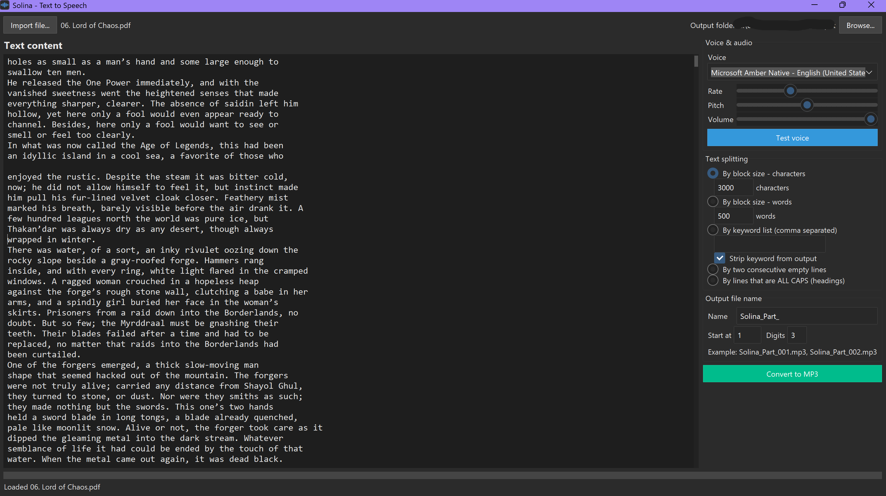
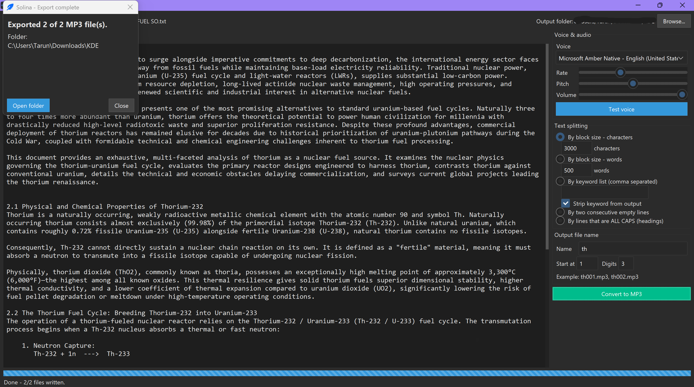

# Solina — Text to Speech for Windows

Turn text, PDFs and EPUB books into MP3 audio files, using the natural-sounding voices already installed on your PC. Dark, minimal and fully offline. Free and open source.



## Features

- **Import** `.txt`, `.pdf` and `.epub` files, or paste your own text. Edit it before converting.
- **Many voices** – every Windows SAPI5 voice on your PC appears in the dropdown.
- **Test voice** button to hear a sample before converting.
- **Rate, pitch and volume** controls.
- **Flexible text splitting** – turn one long text into many audio files:

  | Mode | What it does |
  |---|---|
  | By characters | Blocks of a custom size, cut at the end of a sentence |
  | By words | Blocks of a custom number of words |
  | By keyword list | New file at each keyword (e.g. `Chapter, Part I, Epilogue`), optionally removing the keyword |
  | By two empty lines | New file wherever two blank lines occur |
  | By ALL CAPS lines | New file at each heading written in capitals |

- **MP3 output** to any folder you choose, with a **custom file name** (for example `tk 01.mp3`, `tk 02.mp3`, …).
- Shows how many files will be created before it starts, with a progress bar and an *Open folder* button when done.
- Runs locally. Solina has no telemetry and does not send your text anywhere.



## Download and install (no Python needed)

**Requirements:** Windows 10 or 11, 64-bit.

1. Open the **[Releases page](https://github.com/tarun259952/Solina/releases/latest)**.
2. Under **Assets**, download **`Solina_Setup_1.0.0.exe`**.
3. Double-click it. If Windows shows *"Windows protected your PC"*, click **More info → Run anyway**. (The installer is not code-signed, so Windows doesn't recognise the publisher.)
4. Follow the wizard (choose a folder, optionally add a desktop shortcut) and click **Install**.
5. Launch **Solina** from the Start menu or the desktop shortcut.

The app installs for your user only, so no administrator rights are needed. It lives in `%LocalAppData%\Programs\Solina` by default. FFmpeg (needed for MP3 export) is included.

**Uninstall:** Windows *Settings → Apps → Installed apps → Solina → Uninstall*.

## Quick start

1. Click **Import file…** (or paste text into the editor).
2. Pick a **voice** and press **Test voice**. Adjust rate, pitch and volume.
3. Choose a **text splitting** mode (or leave the default).
4. Set the **output folder** (top right) and the **output file name** (right panel).
5. Click **Convert to MP3**, confirm the number of files, and wait for it to finish.

## Tips

- Use voices labelled **Native** or **Desktop**. Voices labelled **Online** usually can't be saved to files by Windows.
- Only voices registered with Windows SAPI5 appear in Solina. If a voice is missing, it isn't exposed to SAPI5 on your PC.
- Scanned PDFs (pictures of pages) contain no text, so they can't be read without OCR.

## Run from source

Requires **64-bit Python 3.10+** on Windows.

```bat
git clone https://github.com/tarun259952/Solina.git
cd Solina
python -m venv .venv
.venv\Scripts\activate
pip install -r requirements.txt
winget install Gyan.FFmpeg
python solina.py
```

- **FFmpeg** is needed for MP3 export. After `winget install Gyan.FFmpeg`, open a *new* terminal so `PATH` refreshes. Alternatively, put `ffmpeg.exe` next to `solina.py`.
- **Diagnostics:** `python solina.py --diag` checks 64-bit Python, FFmpeg, the output folder, your voices, and a test WAV → MP3 export, and prints PASS/FAIL for each step.
- Errors are logged to `solina_log.txt` next to the script.

## Build the installer yourself

You need Python with the requirements above, [PyInstaller](https://pyinstaller.org/), and [Inno Setup](https://jrsoftware.org/isinfo.php) (6.3 or newer, including 7).

```bat
pip install pyinstaller
winget install JRSoftware.InnoSetup
build.bat
```

`build.bat` does four things:
1. Builds `dist\Solina\Solina.exe` with PyInstaller (`--onedir --noconsole`).
2. Bundles `solina.ico` as the app and installer icon (if present).
3. Copies `ffmpeg.exe` into the app folder (from next to `build.bat`, or from your `PATH`).
4. Compiles `Solina.iss` with Inno Setup into `installer_output\Solina_Setup_1.0.0.exe`.

If the built app closes immediately, remove `--noconsole` from `build.bat`, rebuild, and start `dist\Solina\Solina.exe` from a terminal to see the error.

## Project structure

| File | Purpose |
|---|---|
| `solina.py` | The whole app: text extraction, text splitting, SAPI5 engine, MP3 conversion, GUI, diagnostics |
| `solina.ico` | App and installer icon |
| `build.bat` | One-command build (PyInstaller → Inno Setup) |
| `Solina.iss` | Inno Setup script for the installation wizard |
| `requirements.txt` | Python dependencies |

## How it works

- The GUI is built with **Tkinter + ttkbootstrap** (dark theme).
- Voices are listed with `pyttsx3`; speaking and exporting use **Windows SAPI5 directly** through `comtypes` (`SpVoice` + `SpFileStream`), which supports pitch and writes reliable WAV files.
- Each text block is rendered to a temporary WAV, then converted to MP3 with **pydub + FFmpeg**.
- Conversion runs on a background thread (with its own COM apartment) and reports progress to the UI through a queue.

## Troubleshooting

| Problem | What to do |
|---|---|
| Windows warns about an unknown publisher | Click **More info → Run anyway**. |
| Antivirus flags the installer | This can happen with apps packaged from Python. Please report it in *Issues* and include your antivirus name. |
| "ffmpeg was not found" (running from source) | `winget install Gyan.FFmpeg`, then open a new terminal, or put `ffmpeg.exe` next to `solina.py`. |
| A conversion fails | Try a Native or Desktop voice. Details are in `solina_log.txt`; attach it when opening an *Issue*. |
| Files are overwritten | Solina asks before overwriting existing files with the same name. |

## Contributing

Bug reports, ideas and pull requests are welcome. Please open an **[Issue](https://github.com/tarun259952/Solina/issues)** first for larger changes. Run `python solina.py --diag` before and after your change to check that export still works.

## Changelog

- **1.0.0** – First public release.

## License

Solina is released under the **[GNU Affero General Public License v3.0](LICENSE)** (AGPL-3.0). It uses PyMuPDF and EbookLib, which are AGPL-licensed, so Solina is licensed the same way. You are free to use, study, modify and share it under those terms.

**Third-party software**

| Component | License |
|---|---|
| [FFmpeg](https://ffmpeg.org/) (bundled in the installer as a separate program) | GPL (see ffmpeg.org for the build's exact terms and source) |
| [PyMuPDF](https://github.com/pymupdf/PyMuPDF) | AGPL-3.0 (or commercial) |
| [EbookLib](https://github.com/aerkalov/ebooklib) | AGPL-3.0 |
| [ttkbootstrap](https://github.com/israel-dryer/ttkbootstrap), [comtypes](https://github.com/enthought/comtypes), [pydub](https://github.com/jiaaro/pydub), [Beautiful Soup](https://www.crummy.com/software/BeautifulSoup/) | MIT |
| [pyttsx3](https://github.com/nateshmbhat/pyttsx3) | MPL-2.0 |
| [pywin32](https://github.com/mhammond/pywin32) | PSF |

Licenses can change between versions, so check each project's page for its current terms.

## 🤝 Let's Connect!

If u have any thing to discuss regarding the project I would love to connect 

Thank You 

* 💼 **LinkedIn:** [Connect with me on LinkedIn](https://www.linkedin.com/in/tarun-panigrahi-523534325)
* 🐙 **GitHub:** [Follow my latest projects](https://github.com/tarun259952)
* 📧 **Gmail:** [Send me an email](mailto:tarunpanigrahi259@gmail.com)
